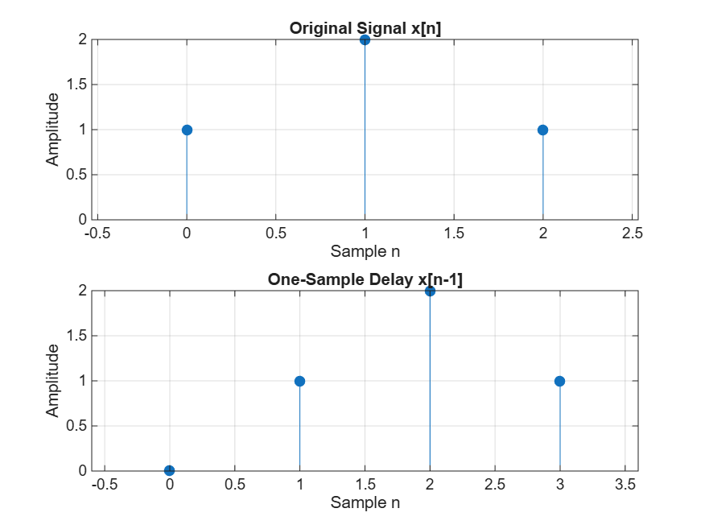
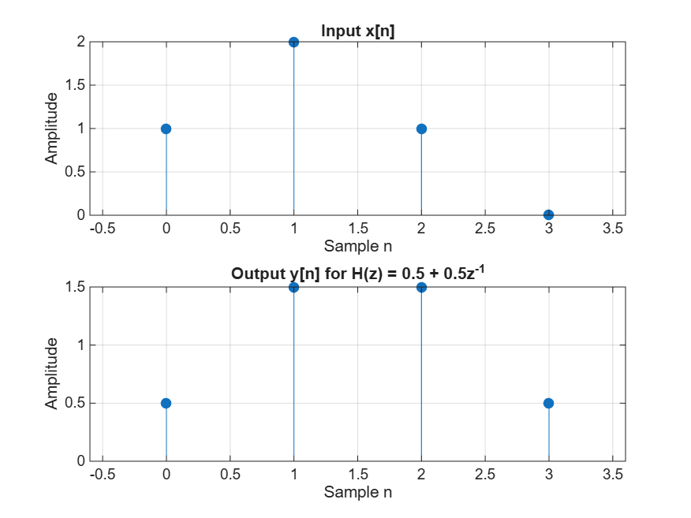
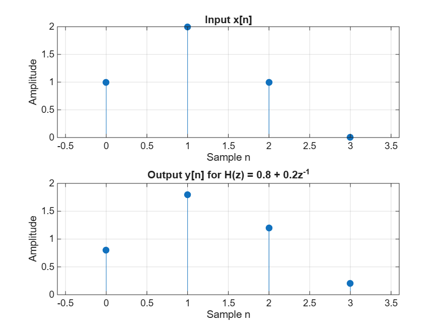

# Z-Transform, Signal Delays, and Digital Filters in MATLAB

This repository contains MATLAB code, visual outputs, and answers for the discrete-time signals and systems exercise focusing on Z-transforms, one-sample delays, and linear time-invariant (LTI) systems.

---

## Repository Contents
* `z_transform_exercise.m` - The complete MATLAB script containing all tasks and figure export commands.
* `original_and_delayed_signals.png` - Plot showing the original signal $x[n]$ and the delayed signal $x[n-1]$ (Part 1).
* `system_response_part2.png` - Plot showing the input vs. output response for $H(z) = 0.5 + 0.5z^{-1}$ (Part 2).
* `updated_system_response_task6.png` - Plot showing the input vs. output response for the updated system $H(z) = 0.8 + 0.2z^{-1}$ (Task 6).

---

## Answers to Questions

### Part 1: A Signal and its Z-Transform

#### 1. Identify the sample represented by each term in $X(z)$.
* **$1$**: Represents the sample at $n = 0$, meaning $x[0] = 1$ (multiplied by $z^0 = 1$).
* **$2z^{-1}$**: Represents the sample at $n = 1$, meaning $x[1] = 2$, delayed by one sample interval.
* **$z^{-2}$**: Represents the sample at $n = 2$, meaning $x[2] = 1$, delayed by two sample intervals.

#### 2. Write the Z-transform of the delayed signal.
The delayed signal is $x_{\text{delayed}}[n] = [0, 1, 2, 1]$ starting at $n = 0$. Its Z-transform is:
$$X_{\text{delayed}}(z) = 0 + 1z^{-1} + 2z^{-2} + 1z^{-3} = z^{-1} + 2z^{-2} + z^{-3}$$

#### 3. Explain why delaying the signal by one sample multiplies $X(z)$ by $z^{-1}$.
According to the time-shifting property of the Z-transform, delaying a signal in the time domain by one sample shifts every term's index by $1$, introducing a factor of $z^{-1}$. Factoring this out multiplies the entire original Z-transform $X(z)$ by $z^{-1}$.

---

### Part 2: A System with One Sample Delay

#### 4. Calculate $y[0]$, $y[1]$, $y[2]$ and $y[3]$ by hand. Compare them with MATLAB.
Given $x_{\text{input}} = [1, 2, 1, 0]$ (where $x[-1] = 0$):
* $y[0] = 0.5(1) + 0.5(0) = \mathbf{0.5}$
* $y[1] = 0.5(2) + 0.5(1) = \mathbf{1.5}$
* $y[2] = 0.5(1) + 0.5(2) = \mathbf{1.5}$
* $y[3] = 0.5(0) + 0.5(1) = \mathbf{0.5}$

* **Comparison:** The MATLAB `filter` output matches these manual calculations exactly (`[0.5, 1.5, 1.5, 0.5]`).

#### 5. Explain how `b = [0.5 0.5]` represents the two terms in $H(z)$.
In MATLAB, the vector `b` stores feedforward filter coefficients corresponding to descending powers of $z^{-1}$ ($H(z) = b_0 + b_1 z^{-1}$). Here, $b_0 = 0.5$ represents the current input term ($0.5x[n]$), and $b_1 = 0.5$ represents the delayed input term ($0.5x[n-1]$).

#### 6. Change the system to $H(z) = 0.8 + 0.2z^{-1}$. Explain which input sample now has more influence on the output.
* **Explanation:** The current input sample $x[n]$ now has more influence on the output because its coefficient ($0.8$) is higher than that of the previous sample $x[n-1]$ ($0.2$). The system responds more directly to immediate changes rather than averaging them out equally.

---

## Plots

### Original and Delayed Signals

### System Response: $H(z) = 0.5 + 0.5z^{-1}$

### Updated System Response: $H(z) = 0.8 + 0.2z^{-1}$

